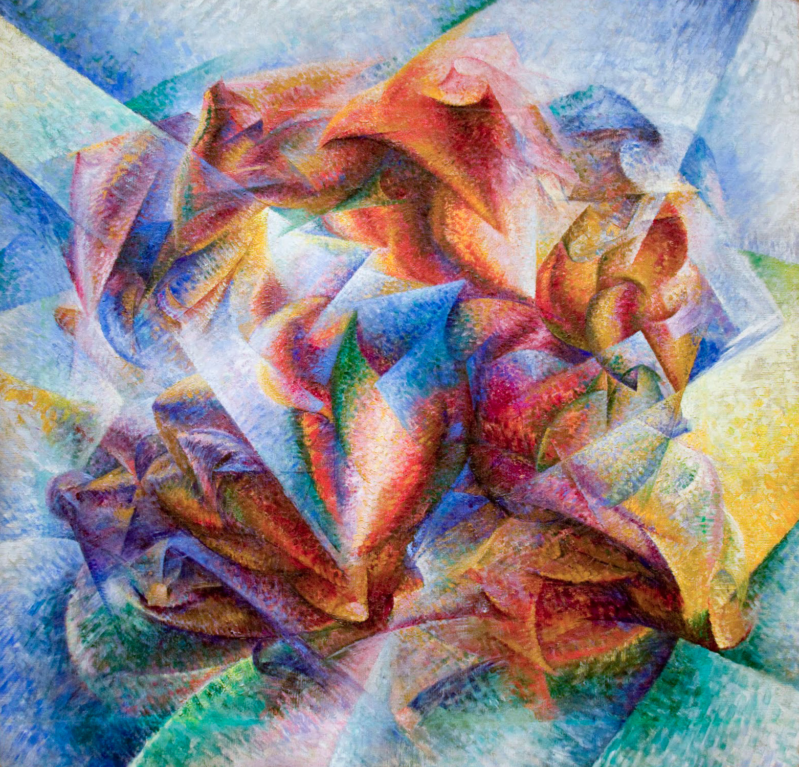

<figure style="width: 90%; margin: 0 auto 1.5em;">
  
  <figcaption style="color: #777; margin-top: 0.5em;">
    Umberto Boccioni, <a href="https://www.arthistoryproject.com/artists/umberto-boccioni/dynamism-of-a-soccer-player/"><em>Dynamism of a Soccer Player</em></a>, 1913.
  </figcaption>
</figure>

> *There was joy in concentration, and the world afforded an inexhaustible wealth of projects to concentrate on. There was joy in effort, and the world resisted effort to just the right degree, and yielded to it at last. People cut Mount Rushmore into faces; they chipped here and there for years. People slowed the spread of yellow fever; they sprayed the Isthmus of Panama puddle by puddle. Effort alone I loved. Some days I would have been happy to push a pole around a threshing floor like an ox, for the pleasure of moving the heavy stone and watching my knees rise in turn. — Annie Dillard, An American Childhood*

What motivates programmers?

When they encounter and accept a tough job, when they *want* to do it, there can be a handful of motivations at work. Maybe they see a lot of money in it, a chance to make it big and then get out. Maybe somewhere in the job there’s an interesting program to be forged. If you believe *The Social Network* (you shouldn’t) Zuckerberg did it all for a girl— the one that got away.

After eight years of startups (series C, D, E, F, A, B, C, D) I have learned that above it all, I’m playing pinball. The point of playing is to keep playing, to secure another go at it.

> "You win one game you get to play another. You win with this machine you get to build the next. Pinball was what counted." — *The Soul of a New Machine*

In the grind it can seem like you need an end. There will be hard days, disappointing days, days of defeat and doubt.

> “In a startup, there's always some disaster happening. So if you're the least bit inclined to find an excuse to quit, there's always one right there.” — Paul Graham (pg)

In fact, startups can look like a way to get to ‘the end’ faster. As pg says, “economically, you can think of a startup as a way to compress your whole working life into a few years. Instead of working at a low intensity for forty years, you work as hard as you possibly can for four.” When I was in school, daunted by the prospect of the forty year 9-5 grind, this certainly seemed appealing.

But if you work as hard as you can for four years and want another four, if you worked that hard *to* win another four, a *bigger* four, you’re playing pinball. Do a good job, and you win the right to do it again.

> Nach dem Spiel ist vor dem Spiel. *After the game is before the game.*
>
> Einmal, immer. *Once, always.*

To some, this infinite game is a trap. They might say it’s a pie eating contest where the prize is more pie. They might say, wryly, “one must imagine Sisyphus happy”. Fair enough.

Maybe someday I’ll stop playing pinball, lose the love of the game. Sometimes I think about travelling so languorously I forget what month it is. Sometimes I think of all the great books I’ll never read. I’ll be a father soon, and beyond the event horizon of my daughter’s first wide-eyed, engrossing stare there’s profound and ineffable change.

But right now I do my job for the opportunity to keep doing it, only bigger and better. I show up for the team because the people I work with are so young and so capable. It’s all ahead of us. The world offers an inexhaustible wealth of ambitious projects, and in ten years Modal’s talented young’uns will be all over them.

Modal just raised its Series D, and reached a milestone $1B revenue run-rate. Another round for around round. We’ve got lots more to build, much to learn. Right now, I am happy that with each passing year, after so much effort, and pains of frustration, I’m eager for another go. How dull it is to pause, to make an end. I still find joy in the endeavor.

“What motivates people?”, asks a pep-talking regional sales lead in the epilogue of Tracy Kidder’s computer industry tour de force. He answers his own question: “Ego and the money to buy things that they and their families want.”  
I can’t say that the money isn’t motivating. And computers don’t get made if they won’t get sold. Every startup engineer is forward deployed. Money matters.

But when I fill out my occupation on immigration forms in the year of our Claude, 2026, I put “programmer”. It’s always about a [better computer](https://modal.com/blog/modal-is-a-computer), and the chance to build it.

D is for “do it again”. Play pinball.
